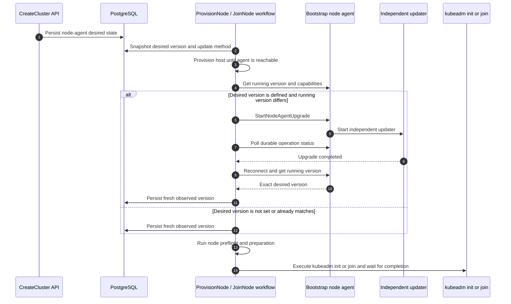
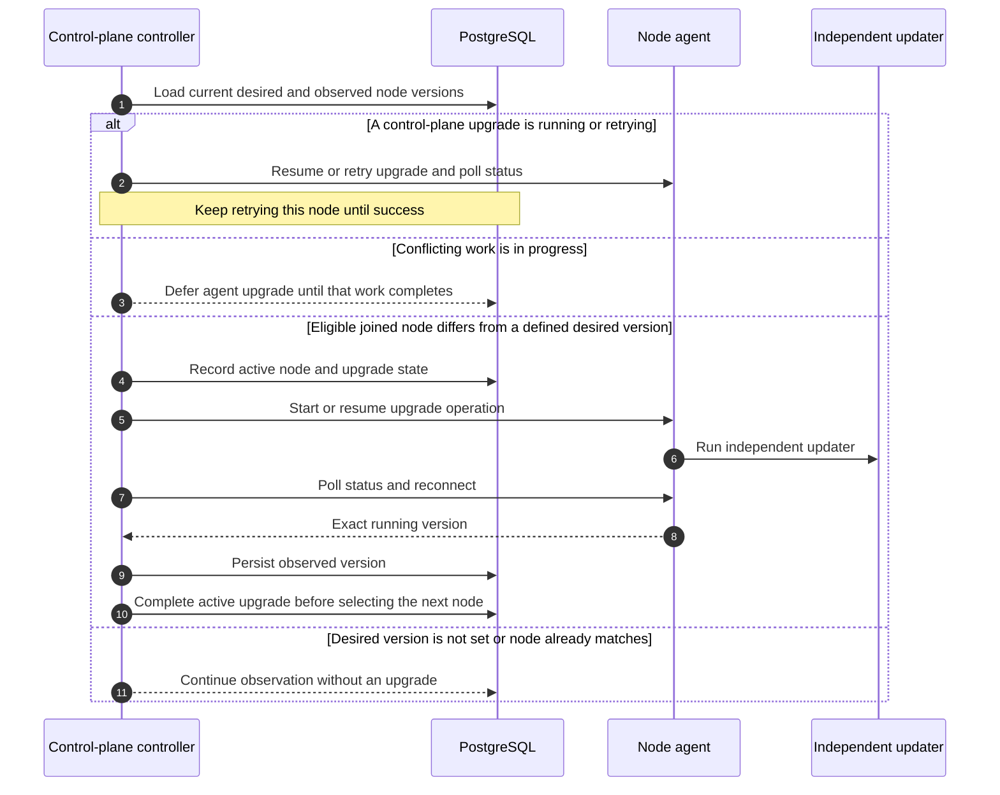

# 控制器驱动的节点代理期望版本更新

> 状态：选定设计方案
>
> 跟踪：[dsx-ai-factory/nvke#205](https://github.com/dsx-ai-factory/nvke/issues/205)
>
> 这是选定的控制器驱动方案。此前的
> [集群锁滚动设计](in-place-rollout-design.md) 保留用于对比。

## 概述

目前升级节点代理需要滚动裸金属节点，使用包含期望代理版本的新 OS 镜像。管理裸金属节点生命周期困难且易错，导致代理升级依赖节点滚动更新，即使只需要变更代理。

NVKE 记录每个节点观测到的代理版本，但不维护期望版本。原地代理更新让 NVKE 无需替换节点即可变更该版本。新节点仍以 OS 镜像内置的代理启动。如果该版本与期望版本不同，NVKE 在预检和 kubeadm 之前安装期望版本。

此前的集群锁方案增加了期望状态，但在控制平面代理收敛期间阻塞无关的拓扑和集群更新。下面的方案将收敛保持在需要它的生命周期中，并在节点边界协调冲突操作。

## 方案

**期望节点代理版本是 `controlPlaneConfig` 的一部分。生命周期工作流在预检和 kubeadm 之前将控制平面节点收敛到该版本。后台协调处理已加入节点后续的漂移。**

本方案涵盖节点代理收敛及其所需的协调。不重新设计集群编排或其他系统组件的升级。池管理的控制平面和工作节点不在范围内。未来的工作节点支持可使用大致相同的机制。

### 设计不变量

1. 定义了期望版本时，控制平面节点的代理未运行该确切版本前，kubeadm 不在该节点上运行。
2. 变更期望版本不中断进行中的操作。
3. 节点上代理升级仍在运行时，不在该节点上启动其他操作。
   - 理由：代理升级具有破坏性，因为它重启代理并断开控制器与节点的连接。
4. 同一时间只有一个破坏性操作作用于节点。只有删除和修复可以抢占其他操作。
5. 后台升级只作用于已加入集群的节点。
6. 后台升级运行或重试期间，其他控制平面节点不启动代理升级。控制器将失败视为瞬态，持续重试同一节点直到升级成功。
7. 控制器对代理的每次调用都兼容集群中存在的任何代理版本。参见
   [Day 1 兼容性契约](#day-1-控制器代理兼容性契约)。

### 为何不用集群级锁？

集群级锁使无关更新等待整个代理滚动完成，包括单个故障节点的重试。控制平面控制器对代理升级排序并推迟冲突工作。无需节点所有权锁。

## API 契约

API 将期望版本持久化在 `controlPlaneConfig.nodeAgentConfig.version`。每节点观测记录运行中的版本。控制平面配置仍是期望版本的来源。

### CreateCluster

`CreateCluster` 将初始期望版本持久化在 `controlPlaneConfig`：

```json
{
  "controlPlaneConfig": {
    "nodeAgentConfig": {
      "version": "v0.1.33"
    }
  }
}
```

操作者通过 `CreateCluster` 或 `UpdateCluster` 设置非空的
`controlPlaneConfig.nodeAgentConfig.version` 来选择启用。缺失或空的期望版本同时禁用原地更新和生命周期版本步骤。

API 接受确切的发布版和预发布版 SemVer，如 `v0.3.0-rc.2`。
缺失时添加 `v` 前缀。

### UpdateCluster

`UpdateCluster` 是创建后变更期望节点代理版本的唯一 API 路径。使用与
`CreateCluster` 相同的 `nodeAgentConfig` 结构。

- API 记录新的期望版本后返回。不等待代理收敛。
- 允许降级，路径与升级相同。
- 控制器将升级失败视为瞬态并自动持续重试。重试继续期间 `GetCluster` 报告当前失败。
  操作者无需重新提交期望版本以触发重试。

### NVKE 控制器配置

| 设置 | 必需 | 值 | 用途 |
|---|---|---|---|
| `nodeAgent.updateMethod` | 是 | `apt` 或 `bundle` | 代理的安装方式 |

控制平面节点始终每集群一次升级一个。不可配置。

## 共享节点代理收敛操作

生命周期工作流和后台协调使用同一操作：

```text
EnsureNodeAgentVersion(
    nodeID,
    desiredVersion,
    updateMethod
)
```

1. 读取并持久化运行版本和观测时间。未设置期望版本或已匹配时，返回 `Unchanged`。
2. 发现升级能力，使用类型化 RPC 或 Day 1 回退路径启动或恢复幂等升级。
3. 跨代理重启轮询持久操作状态。两条路径必须提供等效的持久状态。
4. 建立新的已认证连接，验证确切期望版本，并在返回成功前持久化新观测。

控制平面控制器在整个操作期间跟踪活动升级。以下各节说明各调用方在何处调用它。

## 生命周期工作流集成

生命周期工作流从 `controlPlaneConfig` 快照期望版本和更新方法。它配置主机直到 OS 镜像内置的代理可达。在预检和准备之前直接调用
`EnsureNodeAgentVersion`。该操作成功或返回 `Unchanged` 后 kubeadm 才继续。

如果操作者选择将 `controlPlaneConfig.nodeAgentConfig.version` 设置为非空有效版本，则必须在滚动节点更新期间保持 OS 镜像的代理版本等于期望版本。滚动更新前，操作者必须更新镜像或期望版本使两者匹配。较新的 OS 镜像不会自动变更期望版本。如果启动时版本不同，NVKE 先安装期望版本，必要时包括降级。

### 配置与加入序列



### 现有工作流拆分

对于控制平面控制器管理的节点：

1. `ProvisionNode` 配置主机。
2. 引导代理可达后，`ProvisionNode` 调用
   `EnsureNodeAgentVersion`。
3. 运行剩余的预检和准备步骤。
4. 将节点标记为 `ReadyToJoin`。
5. 控制平面控制器启动串行化的 `JoinNode` 工作流。
6. `JoinNode` 使用持久化的生命周期快照并继续 kubeadm
   加入。

后台升级只作用于已加入节点（[不变量 5](#设计不变量)），因此 `ProvisionNode` 与 `JoinNode` 之间没有其他操作升级代理，包括 `ReadyToJoin` 间隔期间。

## 后台协调

加入后，控制平面控制器比较
`controlPlaneConfig` 中的期望版本与每个控制平面节点的观测版本。数据库变更事件和定期重新同步使用期望版本、观测、生命周期和健康条件以及活动操作触发协调。

无期望版本时，NVKE 仅观测。有冲突工作的节点被推迟。对于版本漂移的合格已加入节点，控制器记录活动升级并直接启动或恢复 `EnsureNodeAgentVersion`。它在后续协调中持久化升级状态并轮询状态。控制平面控制器每集群一次只启动一个后台代理升级，跨副本和重启。

### 协调序列



这也涵盖较旧 OS 镜像或恢复的构建产物导致的漂移，以及重新变为可达的节点。每次升级记录实际运行的版本，下次协调将该观测与当前期望版本比较。

## 执行协调

代理升级可能在加入工作流使用代理时重启代理，删除可能在升级仍在运行时移除节点。两种操作都可能失败或作用于状态已变化的节点。
执行协调防止同一节点上的这种重叠。

控制平面控制器对后台代理升级排序，如同它已对加入和请求删除排序。它使用现有的集群行事务选择和记录工作。

1. 在启动异步代理操作前记录活动节点和升级状态。数据库事务在升级完成前结束。
2. 在后续协调中，先恢复该升级再选择其他节点。持续重试瞬态失败，并确保运行版本在标记成功前匹配目标。
3. 代理升级运行期间推迟冲突的加入、Kubernetes 升级、滚动替换和删除。无关的观测和主机配置可继续。删除和修复可在继续前取消升级。集群删除不需要代理响应。
4. 在此控制器之外启动的操作（如证书续期）必须使用相同的调度检查。不得与同一节点上的代理升级重叠。

控制器使用其数据库记录做升级决策。

### 示例：加入期间期望版本变更

`CreateCluster` 将期望版本设为 `v0.1.33`。以较旧代理启动的节点在 kubeadm 前升级到 `v0.1.33`。之后，当扩容节点以 `v0.1.33` 的快照加入时，`UpdateCluster` 将期望版本变更为
`v0.1.34`。

加入节点使用 `v0.1.33` 完成并记录该实际版本。加入后，协调器看到 `v0.1.33` 与 `v0.1.34` 不同并调度下一次升级。其他合格的已加入节点可在该节点加入期间逐个收敛。

## 代理 RPC 与独立更新器

控制器侧模型依赖狭窄的代理侧契约。代理仅暴露类型化节点代理升级操作，而独立更新器在代理进程替换后存活。

当代理支持类型化自升级时，本设计使用与集群锁设计相同的狭窄异步 RPC：

```text
StartNodeAgentUpgrade(target_version, method)
GetNodeAgentUpgradeStatus()
```

`method` 为 `APT` 或 `BUNDLE`，仅由 NVKE 控制器配置提供。RPC 不接受包名、URL、路径、安装参数或命令。对于不暴露这些 RPC 的较旧代理，Day 1 兼容性契约允许控制器改用现有的 shell 脚本 runbook 路径。

对相同目标版本和方法的重复请求恢复活动升级。如果之前的升级失败，控制器重复请求以重试。代理重启后状态仍可读。

代理在节点上持久化请求和状态，并无阻塞地启动独立的 systemd 更新器。更新器负责暂存、安装、重启、验证和本地恢复，因此重试无需依赖 gRPC 服务器进程即可恢复。

## Day 1 控制器代理兼容性契约

目前 NVKE 控制器通常比其管理的一些代理更新。滚动期间，不同节点暴露不同能力，因此兼容性是代理 API 每个控制器调用方的责任。

### 兼容性模型

在调用新引入的 RPC 前发现能力。支持时使用类型化 RPC。否则使用等效的 shell 脚本 runbook 路径。对于节点代理升级，该回退必须提供共享操作中描述的相同持久操作状态、重试行为和确切的重启后版本验证。由于重启代理会杀死其运行的脚本，回退在代理服务之外启动更新，例如使用 `systemd-run`。RPC 不可用不意味着请求的工作成功。Protobuf 变更应保持增量和向后兼容。

此契约避免了严格的控制器/代理版本矩阵：不同 OS 镜像内置的代理可在同一集群内不同，控制器可先于代理升级，开源部署不应需要同步升级每个组件。调用方在整个收敛过程中为每个节点选择支持的路径。