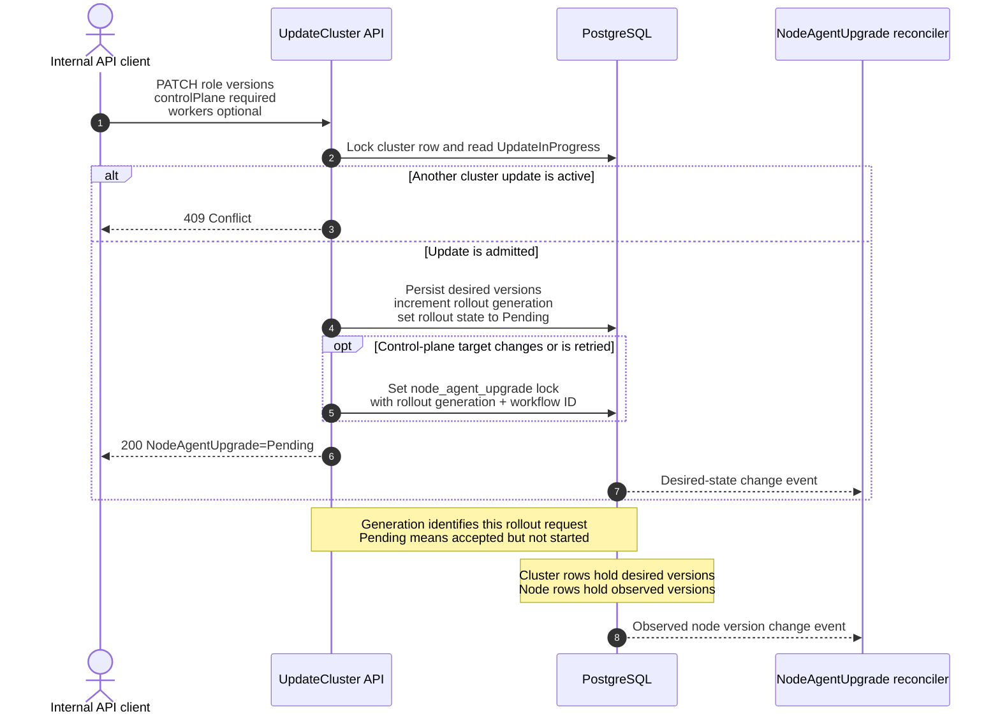
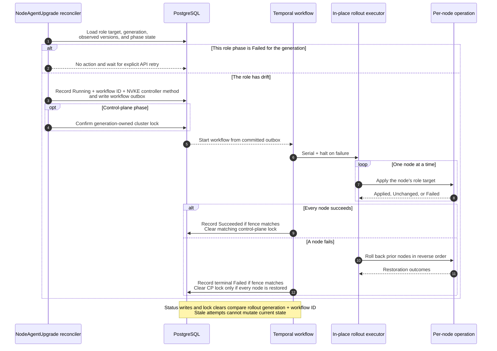
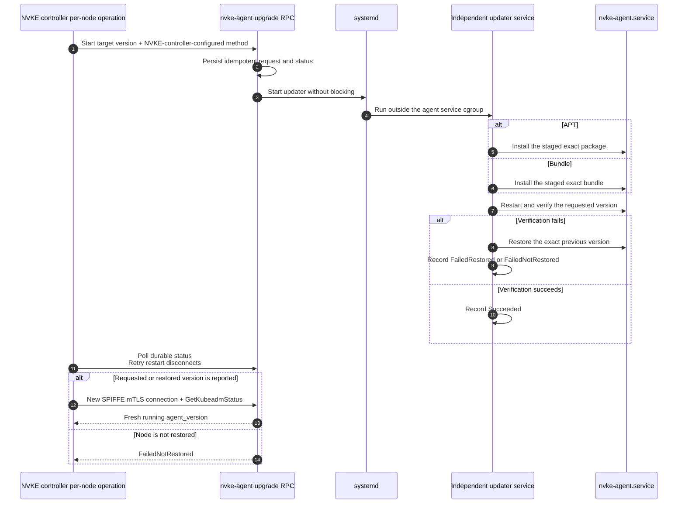

# Node-agent 期望状态原地滚动更新

> 状态：评审草案
>
> 跟踪：[dsx-ai-factory/nvke#205](https://github.com/dsx-ai-factory/nvke/issues/205)
>
> 这是选定控制器驱动期望状态方案之前考虑的集群锁设计。

## 问题

NVKE 记录每个节点观测到的 agent 版本，但没有集群级的期望 agent 配置，也没有将节点收敛到该配置的控制器。APT 也无法在 `nvke-agent.service` 内部安全替换 agent：Debian 的 `prerm` 会停止该服务，systemd 因此可能终止包事务。

## 方案摘要

`UpdateCluster` 持久化期望的 node-agent 版本。DB 驱动的控制器通过现有原地滚动更新框架调用 Temporal workflow，一次一个节点，将实际 node-agent 版本收敛到期望版本。本设计优先对控制平面节点的 agent 做原地滚动更新，同时保留对 worker 节点上 node agent 的滚动更新能力。控制平面滚动更新持有集群更新锁；worker 滚动更新不持有。APT 或 bundle 更新方式通过 NVKE 控制器配置指定。agent RPC 将自我替换委托给独立的 systemd updater。

## 架构时序

### 1. API 与数据库模型



### 2. 协调与滚动更新编排



### 3. 单节点 agent 升级与恢复



## 非目标

- 并行 node-agent 升级。
- Node-agent 构建产物的发布或资格认证。

## 现有集成点

- `nodeagentreadiness` 以 `node-agent-health` 控制器运行，约每两分钟一次。它从 `GetKubeadmStatus` 获取 `agent_version`，并写入 `nodes.agent_version`。
- `UpdateCluster` 已锁定集群行，并用 `conditions.updateInProgress` 串行化集群更新。
- `dbreconcile/dbwrapper` 将集群和节点变更发布到 DB 驱动的控制器数据源，并定期重新同步。
- `controller/internal/rollout` 已提供串行执行、`RollbackHaltOnAnyFailure`、本地恢复结果和逆序回滚。其目标选择目前仅包含控制平面节点。

## API 与持久化状态

### UpdateCluster 契约

在 `UpdateClusterRequest` 和 `Cluster` 响应中增加 `nodeAgentConfig`：

```json
{
  "nodeAgentConfig": {
    "controlPlane": {
      "version": "v0.1.31"
    },
    "workers": {
      "version": "v0.1.30"
    }
  }
}
```

- 更新请求省略顶层 `nodeAgentConfig` 时，当前期望状态保持不变。提供时，`controlPlane` 必填，`workers` 可选。
- 每个提供的角色只需 `version`。API 不暴露安装方式。
- 提供的配置中省略 `workers` 会清除所有 worker 目标并停止 worker 协调。
- 没有 node-agent 滚动更新运行时，将顶层 `nodeAgentConfig` 设为 `null` 会清除所有目标。
- 接受精确的发布 SemVer，并规范化为 `vMAJOR.MINOR.PATCH`。允许降级。规范化后配置相同则为空操作，除非当前控制平面或 worker 阶段为 `Failed`；此时重新提交会显式启动新 generation。
- 另一个 `UpdateInProgress` 操作持有锁时返回 `409`。
- 变更或显式重试时，一个事务递增期望状态 generation、持久化期望版本，并记录 `nodeAgentUpgrade.state=Pending`。当控制平面目标变更或其失败阶段被重试时，设置 `UpdateInProgress=node_agent_upgrade`。控制器为后续控制平面漂移（如替换节点）获取同一带栅栏的锁。仅 worker 变更不设置集群锁。返回 `200` 及 node-agent 状态；HTTP handler 不启动 Temporal。

generation 是已接受期望配置或显式重试的单调递增修订号。`Pending` 表示该修订已提交到 PostgreSQL，但协调器尚未记录 `Running` 或启动其 Temporal workflow。

### Node-agent 更新方式

站点级 NVKE 控制器设置 `nodeAgent.updateMethod`（位于 `nvke-controller-config`，chart 值同名）选择 `apt` 或 `bundle`。集群设置期望 agent 版本时必填，否则可为空。协调器校验该值，并将解析后的值快照到每个 workflow 和节点操作中。更改此设置不会重装 agent，也不会改变进行中的 workflow；它适用于下一个期望状态 generation。构建产物位置和资格认证仍属于发布配置，不是 API 输入。

### 数据库模型

增加集群列：

```text
desired_control_plane_node_agent_version text NOT NULL DEFAULT ''
desired_worker_node_agent_version        text NOT NULL DEFAULT ''
node_agent_config_generation             bigint NOT NULL DEFAULT 0
```

现有 `nodes.agent_version` 仍为实际状态。增加 `nodes.agent_version_observed_at`，使重启前的观测无法满足升级后验证。

集群的 `nodeAgentUpgrade` condition 存储期望配置快照、解析后的方式、generation，以及独立的控制平面和 worker 阶段状态。每个阶段存储拥有该滚动更新尝试的唯一 Temporal workflow ID、`Pending | Running | Succeeded | Failed`、尝试时间及脱敏消息。`Failed` 对该角色阶段和 generation 是终态。`UpdateInProgress` 仍是共享集群变更锁；仅对控制平面阶段在其操作类型枚举中增加 `node_agent_upgrade`。其条目还携带滚动更新 generation 和 Temporal workflow ID，确保只有同一滚动更新尝试才能清除锁。

## 协调与拓扑锁

增加集群级 `nodeagentupgrade` 控制器：

1. 在集群期望状态变更、映射的节点实际状态变更及现有定期重新同步时协调。
2. 配置缺失、集群未就绪或正在删除时返回。不要为当前 generation 中 `Failed` 的角色阶段启动工作；控制平面阶段失败也会阻止 worker 阶段。
3. 目标为已就绪、未删除的控制平面节点。仅当 `nodeAgentConfig.workers` 存在时包含 worker。目标节点正在就绪、删除、回收或修复时等待。
4. 将每个目标与其角色的精确版本比较。`node-agent-health` 控制器约每两分钟刷新存储的版本。更改节点后，单节点操作还会重新连接并调用 `GetKubeadmStatus`；要求重启后的调用报告精确目标版本。存储的升级前版本不满足验证。启动可选 worker 阶段前先协调控制平面节点。
5. 控制平面漂移时，以滚动更新 generation 和 Temporal workflow ID 原子获取集群更新锁。Worker 漂移不获取该锁。
6. 记录 `Running`，快照 `nodeAgent.updateMethod`，并写入 workflow outbox 条目。Workflow 在更改每个节点前重新检查节点生命周期、agent 就绪状态和 RPC 支持。
7. 每次 workflow 状态写入和锁清除都对集群 ID、期望 generation 和 Temporal workflow ID 执行 compare-and-swap。零行更新表示 workflow 已过期；它停止，不更改状态也不释放锁。

Temporal 可在单个运行中的 workflow 内执行有界活动重试。重试耗尽且 workflow 未成功结束后，控制器将该角色阶段记录为 `Failed`，不为该角色和 generation 创建替代 workflow。修复原因后，操作员必须通过 `UpdateCluster` 重新提交相同或新的期望配置；准入会递增 generation 并创建新尝试。worker 阶段失败不阻止后续控制平面漂移收敛。新节点使用配置的目标进行协调，除非其角色阶段为 `Failed`。

集群级拓扑锁仅适用于控制平面阶段。锁激活期间，API handler 和协调器阻止扩缩容、就绪、调度、回收、修复、替换和删除。健康和状态观测继续。仅当匹配的带栅栏 workflow 收敛或完全恢复所有受影响控制平面节点时才清除锁。任何此类节点未证明恢复时保留锁。

失败并已恢复的控制平面阶段清除其匹配锁，但在显式重试前保持 `Failed`。`FailedNotRestored` 表示请求的升级和自动回滚均失败。保留同一 `UpdateInProgress=node_agent_upgrade` 拓扑锁并发出严重告警；这不是单独的失败锁类型。保留的锁在控制平面 agent 状态未知时阻止正常拓扑变更。值班操作员通过带外节点访问，在每个受影响控制平面节点上恢复并验证精确的先前版本。随后仅当锁仍属于同一失败滚动更新尝试时，操作员专用恢复命令才清除锁。它检查存储的 generation（滚动更新修订号）和 Temporal workflow ID。任一值变更时，命令保留锁，因为恢复请求基于过期状态。`FailedNotRestored` 后定期协调永不自动清除保留的锁。

Worker 滚动更新串行执行，但不设置 `UpdateInProgress`，也不阻止无关集群变更。它在每个节点操作前立即重新检查所选 worker 的生命周期，若该节点或期望 generation 变更则停止当前尝试。Worker 失败对其角色阶段和 generation 是终态，但永不保留集群级锁。

## 原地滚动更新编排

扩展滚动更新目标选择，不改变 etcd 加密和 OIDC 使用的控制平面默认值：

```text
TargetControlPlane
TargetWorkers

Strategy:       Serial
RollbackPolicy: HaltOnAnyFailure
```

控制平面和 worker 滚动更新作为独立角色阶段运行。Worker 阶段仅在控制平面收敛后启动，不继承控制平面集群锁。每个角色按节点名排序。阶段启动时快照期望 generation、解析后的方式、角色目标和 Temporal workflow ID；从滚动更新和节点 ID 派生每个单节点操作 ID。

对每个目标节点，滚动更新操作：

1. 读取实时运行版本，精确匹配时返回 `OutcomeUnchanged`。
2. 启动升级并轮询持久状态。重启期间 agent 断开可重试。
3. 成功后通过 SPIFFE mTLS 重新连接，调用 `GetKubeadmStatus`，要求精确目标版本，并以新的 `agent_version_observed_at` 持久化 `agent_version`。
4. 验证的本地恢复映射为 `OutcomeFailedRestored`；否则返回 `OutcomeFailedNotRestored`。

首次失败停止前进。即使 `OutcomeFailedRestored` 也会导致该角色阶段所有先前已应用节点按逆序回滚。Worker 失败不回滚已收敛的控制平面。仅当控制平面集群锁仍属于同一滚动更新尝试且每个受影响控制平面节点均证明恢复时才清除。

## Agent RPC 与独立 updater

增加窄异步 RPC：

```text
StartNodeAgentUpgrade(operation_id, target_version, method)
GetNodeAgentUpgradeStatus(operation_id)
StartNodeAgentRollback(operation_id, upgrade_operation_id)
```

`method` 为 `APT` 或 `BUNDLE`，仅由 NVKE 控制器配置提供；不是集群 API 输入。RPC 不接受包名、URL、路径、安装参数或命令。Debian 包名仍为 `nvke-agent`。`InstallPackages` 通过移除 `=version` 或 `:architecture` 限定符规范化每个包参数，并识别 `nvke-agent_*.deb` 路径；拒绝所有匹配。`InstallBundle` 拒绝现有 `agent` bundle 组件。能力预检不得回退到任一通用 RPC。

相同操作 ID 和请求返回现有状态；相同 ID 的不同输入返回 `AlreadyExists`。并发 updater 操作返回 `FailedPrecondition`。状态在 agent 重启后仍可读，记录操作、方式、先前和目标版本、阶段、结果、构建产物标识、时间戳及脱敏错误。

RPC 在 `/var/lib/nvke/agent-upgrades/<operation-id>/` 下原子写入请求和初始状态，然后运行：

```text
systemctl start --no-block nvke-agent-updater@<operation-id>.service
```

PID 1 在独立服务 cgroup 中启动 `nvke-agent-updater`。Updater 负责暂存、安装、重启、本地验证和本地恢复。单例锁防止任务重叠，原子状态写入使重试和 updater 重启可恢复，不依赖 gRPC 服务器进程。

### APT 方式

停止 agent 前，解析并验证精确目标和回滚 `.deb` 文件。以 `--allow-downgrades` 非交互安装目标，然后验证 `dpkg-query`、已安装二进制版本和 `nvke-agent.service`。配置的仓库 suite 和 APT 选择节点的 OS 发行版和原生架构；RPC 仅提供精确版本。失败时恢复并验证精确的先前包。

### Bundle 方式

停止 agent 前，验证精确 bundle 并快照当前二进制和 agent 拥有的服务配置。使用固定的 agent 拥有入口点，不带调用方参数，并保留 `/etc/default/nvke-agent`。失败时恢复快照、重载 systemd、重启服务并验证精确的先前版本。

Updater 仅在验证先前版本后报告 `FailedRestored`；否则报告 `FailedNotRestored`。

## 可观测性

用单个有界结果标签跟踪已完成的 node-agent 升级：`success` 或 `failure`。

## 兼容性与引导

现有 agent 通过一次性基于 bash 的精确版本 APT 引导 runbook 到达包含 RPC 和 updater 的首个发布版本。之后由控制器管理升级和降级。没有 `nodeAgentConfig` 的集群保持不变；若任何目标节点缺少专用 RPC，预检在变更前失败。