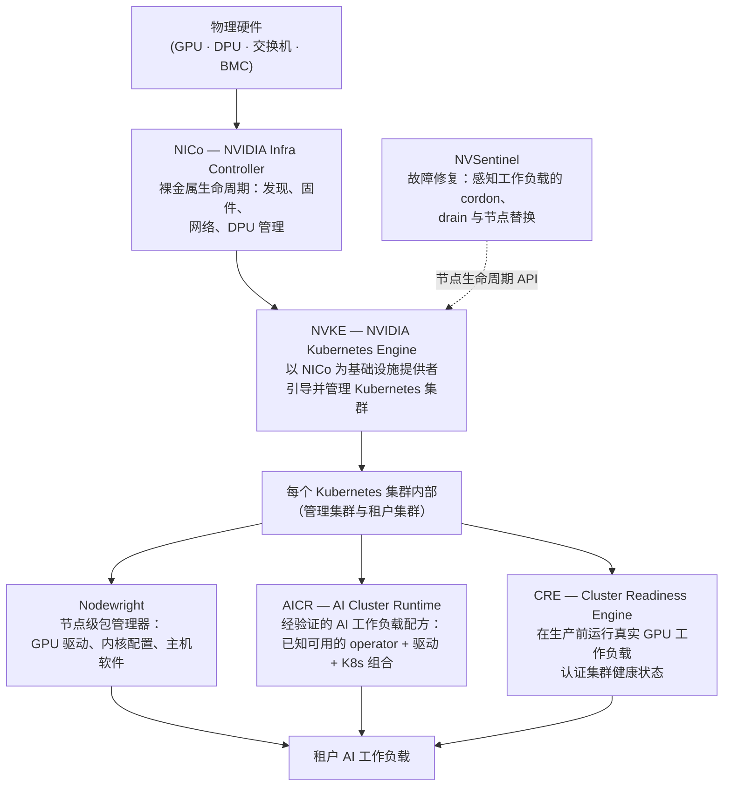

# DSX 技术栈中的 NVKE

NVKE 是 AI 工厂基础设施开源组件体系中的一层。了解 NVKE 所处的位置——以及它的边界——有助于你判断该选用哪些组件、按什么顺序使用。

## 技术栈

## 各组件职责

### NICo（NVIDIA Infra Controller）

NICo 管理 Kubernetes 层以下的裸金属机器生命周期：BMC 访问、固件更新、网络配置、DPU 管理和主机置备。它提供 REST API 和一组 Kubernetes 自定义资源，供 CAPI 基础设施提供者驱动。

NVKE 的主要 CAPI 基础设施提供者是 [CAPNICo](https://github.com/dsx-ai-factory/cluster-api-provider-nico)，它负责将 NVKE 与 NICo 集成。可用的 NICo 站点是 NVKE 第 2 天运维的前提——创建租户集群、增删节点和升级都要经过 NICo。

[NICo 文档](https://docs.nvidia.com/infra-controller/documentation/home)

### NVKE（本项目）

NVKE 位于 NICo 与 Kubernetes 工作负载层之间。它引导管理集群，然后通过 NICo（经由 CAPNICo 和 Cluster API）置备并管理租户 Kubernetes 集群。NVKE 用 OVN-Kubernetes 置备集群后即交接——GPU 软件栈、工作负载配置和集群就绪认证由上述组件负责。

**NVKE 的职责范围：**
- 在预置节点上引导管理集群（`nvkectl bootstrap site`）
- 通过 NICo 置备租户 Kubernetes 集群并管理其生命周期
- 驱动 Kubernetes 版本滚动升级、节点增删和节点池扩缩容
- 维护 etcd 加密密钥和集群凭据

**不在 NVKE 范围内：**
- 集群内的 GPU 驱动和软件栈 → 由 AICR 部署 Nodewright + GPU Operator
- 集群就绪认证 → CRE
- 感知工作负载的节点故障修复 → NVSentinel

### Nodewright

Nodewright 是 Kubernetes 原生的包管理器，用于主机级变更。它无需重装系统即可在节点上安装、更新和移除包，并通过感知 Kubernetes 的调度保护运行中的工作负载。NVKE 置备租户集群后，Nodewright（经 AICR 部署）会在每个节点上配置 GPU 软件栈。

[Nodewright 文档](https://docs.nvidia.com/nodewright)

### AICR（AI Cluster Runtime）

AICR 发布经验证的配方——GPU Operator、驱动、内核配置和 Kubernetes 的版本锁定组合，已知可协同工作。每个配方会渲染为可直接部署的 GitOps 包（ArgoCD、Flux、Helm）。NVKE 引导管理集群并创建租户集群后，运维人员将相应的 AICR 配方包部署到集群，为其配置 AI 工作负载。

[AICR 文档](https://docs.nvidia.com/aicr)

### CRE（Cluster Readiness Engine）

CRE 在生产工作负载运行前认证 GPU 集群工作正常。它在拓扑感知的节点组上运行真实训练和通信工作负载，测量性能、检测硬件故障，并报告每个故障节点及原因。CRE 从不修改节点——隔离由平台负责（通常是 NVSentinel）。

[CRE 文档](https://docs.nvidia.com/cluster-readiness-engine)

### NVSentinel

NVSentinel 是节点健康的故障修复系统。它监控节点的硬件故障，当节点需要修复时，先执行感知工作负载的 cordon 和 drain，再触发 NVKE 的节点替换生命周期。NVKE 提供生命周期 API，NVSentinel 执行 SLO 策略。

[NVSentinel 仓库](https://github.com/NVIDIA/NVSentinel)

## 典型站点上线流程

1. 部署 **NICo** 并搭建裸金属站点——BMC 访问、交换机配置、主机纳管。
2. **NVKE** 在一组预置节点上引导管理集群。
3. 通过 GitOps 将 **NVKE SBOM**（NVKE 控制器、NICo、Temporal、Postgres、SPIRE、CAPNICo）部署到管理集群。
4. 纳管站点：NVKE 连接 NICo，此后可驱动租户集群操作。
5. 通过 `nvkectl create cluster` 创建租户集群。
6. 向租户集群部署 **AICR 配方包**，安装 Nodewright、GPU Operator 及完整的经验证软件栈。
7. **CRE** 认证集群就绪。
8. 配置 **NVSentinel** 进行持续的节点健康监控和故障修复。
9. 调度租户 AI 工作负载。

## 为什么选择 NVKE 而非原生 kubeadm 或 CAPI？

原生 `kubeadm` 能引导 Kubernetes，但不理解 NICo 容量、NVLink 网络结构、经验证的软件配方，也不支持 GPU 集群规模化所需的长时间运行操作（滚动升级、节点替换）。原生 Cluster API 需要基础设施提供者——NICo 是 NVKE 的主要提供者——且不包含工作流引擎或 etcd 加密生命周期。

NVKE 提供将这些部分串联起来的运维层：基于 Temporal 的持久化工作流用于长时间运行操作、etcd 加密密钥管理，以及 CAPNICo 集成，使 CAPI 能驱动 NICo 管理的裸金属。