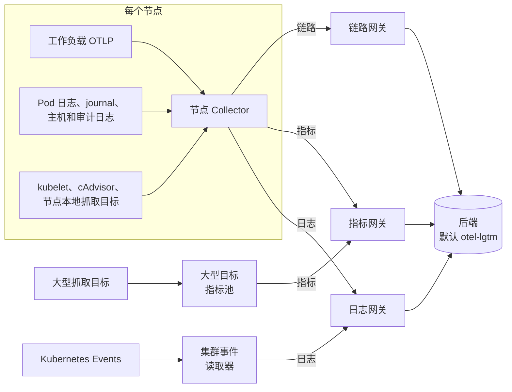
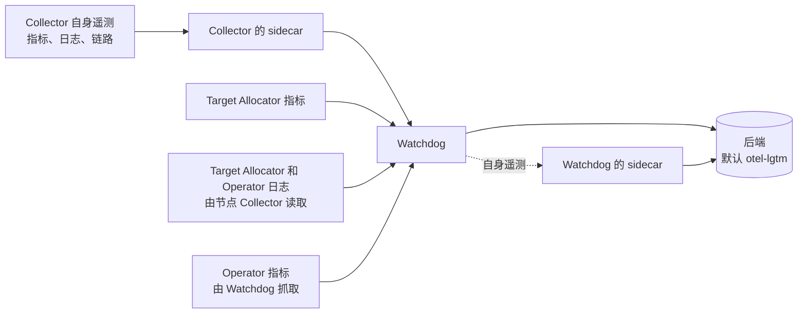

# 拓扑

NVKE 遥测流水线（NKTP）分两层部署 OpenTelemetry Collector。采集层 Collector 在集群内采集遥测数据，并按信号类型转发到对应网关。网关再导出到后端。另有一个独立的 Collector（watchdog）承载流水线自身的遥测数据。

OpenTelemetry Operator 由随附的 opentelemetry-kube-stack chart 安装，根据该 chart 渲染的 `OpenTelemetryCollector` 资源创建每个 Collector 和 Target Allocator。每个 Collector 的配置就是 `values.yaml` 中 `<component>.otelcol.config` 下的原生 YAML，原样渲染；参见[设计原则](../design-principles.md)。下文流程即这些默认配置所定义的流程。

## 数据路径

| Collector | Values 键 | 运行方式 | 采集内容 | 发送至 |
| --- | --- | --- | --- | --- |
| [节点 Collector](../components/node-collector.md) | `daemonset` | 每个节点上的 DaemonSet，包括带污点的节点 | 本节点工作负载的 OTLP、Pod 日志、journal、主机认证和审计日志、Kubernetes API 审计日志、kubelet 和 cAdvisor 指标，以及本节点上的抓取目标 | 各信号对应的网关 |
| [大型目标指标池](../components/large-target-metrics.md) | `large_target_metrics` | StatefulSet，2 到 32 个副本 | 带 `nktp.nvidia.io/large-target: "true"` 标签的 Monitor | 指标网关 |
| [集群事件读取器](../components/cluster-events.md) | `cluster_events` | StatefulSet，2 个副本，一个被选为读取器 | Kubernetes Events | 日志网关 |
| [日志、指标和链路网关](../components/gateways.md) | `gateway_logs`、`gateway_metrics`、`gateway_traces` | 各一个 StatefulSet，2 到 128 个副本 | 基于 gRPC 的 OTLP，使用 mTLS | 后端 |
| [Watchdog](../components/watchdog.md) | `watchdog` | StatefulSet，2 到 16 个副本 | NKTP 组件的自身遥测数据 | 后端 |

每个 Collector 的 exporter 显式指定下一跳。例如，节点 Collector 的 `otlp/metrics` exporter 通过 OTLP/gRPC 发送到 `nktp-gateway-metrics-collector:4317`。要改变某信号的去向，修改该 Collector 配置中的 exporter。

## 指标抓取

三个 Target Allocator 决定由哪个 Collector 副本抓取每个目标。[目标分配设计](../designs/target-allocation.md)说明了每个抓取型 Collector 为何需要一个 Target Allocator。

| Target Allocator | 策略 | 发现 | 分配给 |
| --- | --- | --- | --- |
| 节点（`daemonset`） | `per-node` | 不带大型目标标签的 ServiceMonitor、PodMonitor、Probe 和 ScrapeConfig | 目标所在节点上的节点 Collector |
| 大型目标（`large_target_metrics`） | `consistent-hashing` | 带 `nktp.nvidia.io/large-target: "true"` 的同类资源 | 大型目标池的一个副本 |
| Watchdog（`watchdog`） | `consistent-hashing` | Watchdog 自身的抓取任务；Prometheus CR 发现已关闭 | 一个 Watchdog 副本 |

随附的 exporter 在前两者之间划分：

- node-exporter 和 kube-state-metrics DaemonSet 由同一节点上的节点 Collector 抓取。
- 中央 kube-state-metrics Deployment 和 Kubernetes 控制平面 ServiceMonitor 带大型目标标签，由大型目标池抓取。
- kubelet 和 cAdvisor 不通过 Target Allocator 发现。每个节点 Collector 直接抓取本节点的 kubelet；参见[配置 kubelet 指标](../guides/configure-kubelet-metrics.md)。

每个 Collector 默认通过 mTLS 访问其 Target Allocator；参见[配置 cert-manager](../guides/configure-cert-manager.md#target-allocators)。

## 自身遥测

Watchdog 通过 OTLP/gRPC 加 mTLS 在 `nktp-watchdog-collector:4317` 接收流水线自身的遥测数据，但 allocator 指标例外，使用端口 4320 上的明文 OTLP/gRPC：

- 除 Watchdog 外，每个 Collector 通过 `service.telemetry` 将自身的指标、日志和链路导出到其 Pod 内的 sidecar，再由 sidecar 导出到该地址。参见[自身遥测 sidecar](self-telemetry.md)。
- 每个 Target Allocator 将指标推送到 `nktp-watchdog-collector:4320`。
- 节点 Collector 读取本节点上 Target Allocator 和 Operator 容器的日志，并通过其 `logs/targetallocator` 和 `logs/operator` 流水线发送到该地址。其 Pod 日志读取器会跳过这些文件以及 NKTP Collector 自身的 Pod 日志，因此它们不会同时经日志网关发送。
- Watchdog 自行抓取 Operator 的指标端点。

Watchdog 将收到的数据直接转发到后端。其自身遥测经其 sidecar 发往后端。因此自身遥测不经过网关。自身遥测如何与采集分开缓冲，参见[背压](backpressure.md)。

## 支撑组件

- **OpenTelemetry Operator**（`nktp-operator`）以及 OpenTelemetry 和 Prometheus CRD，来自 opentelemetry-kube-stack。参见[受管依赖](../components/dependencies.md)。
- **kube-state-metrics**：一个 DaemonSet，用于每个节点上调度的 Pod，另有按资源类型分组的中央 Deployment。参见 [kube-state-metrics](../components/kube-state-metrics.md)。
- **node-exporter**：每个节点的主机指标。
- **metrics-server**，默认关闭：自动扩缩器读取的资源指标 API。
- **otel-lgtm**：默认后端，仅供评估。参见 [otel-lgtm](../components/otel-lgtm.md)。

## 扩缩容

网关、大型目标池和 Watchdog 根据 CPU 和内存利用率水平扩缩，这需要 Kubernetes 资源指标 API。节点 Collector 随节点数量扩缩。集群事件读取器运行两个副本，一个活跃、一个待命；增加副本不会提高 watch 吞吐量。参见[调整资源规模](../guides/size-resources.md)。