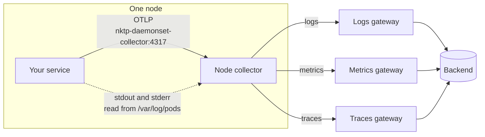
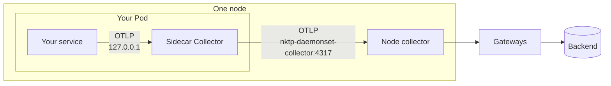

# 向 NKTP 发送遥测数据

本指南面向工作负载运行在启用 NVKE 遥测流水线（NKTP）的集群上的团队，介绍如何向 NKTP 发送遥测数据。

典型配置：

1. 将日志写入 stdout 和 stderr。NKTP 无需配置即可采集。
2. 使用 OpenTelemetry SDK 为服务埋点，采集指标和链路追踪。
3. 配置 SDK 发送到同一节点上的 NKTP 节点采集器。

如果服务暴露 Prometheus 指标，请为其创建 `ServiceMonitor` 或 `PodMonitor`，可以替代 SDK 指标，也可以与 SDK 指标并存。参见 [Prometheus 指标](#prometheus-指标)。

可选：如果希望在遥测数据离开 Pod 之前进行缓冲或处理，可以[添加 sidecar Collector](#添加-sidecar)。

## 遥测数据如何到达 NKTP

NKTP 在每个节点上运行一个节点采集器。节点采集器读取本节点上所有 Pod 的日志，并接收本节点工作负载发来的 OTLP。它将每种信号转发到对应的网关，再由网关导出到后端。完整流水线参见[拓扑](../architecture/topology.md)。



节点采集器端点（`nktp-daemonset-collector:4317`）只将流量路由到发送方所在节点的采集器。如果该采集器未就绪（例如其 Pod 正在重启），发送会失败，不会到达其他节点。

## 日志

将日志写入 stdout 或 stderr，每行一条记录。节点采集器从 `/var/log/pods` 读取日志并发送到日志网关。写入容器内文件的日志不会被采集。

每条记录携带 `k8s.namespace.name`、`k8s.pod.name` 和 `k8s.container.name`。整行内容即为日志正文。

## 为服务埋点

添加对应语言的 OpenTelemetry SDK 以发送指标和链路追踪。[各语言文档](https://opentelemetry.io/docs/languages/)提供了每种受支持语言的入门指南。

## 向节点采集器发送 OTLP

配置 SDK，将 OTLP 日志、指标和链路追踪发送到节点采集器：gRPC 使用 `nktp-daemonset-collector:4317`，HTTP 使用 `http://nktp-daemonset-collector:4318`。从其他命名空间发送时，需用 NKTP 命名空间限定主机名，例如 `nktp-daemonset-collector.nktp:4317`。

将 `OTEL_SERVICE_NAME` 设置为服务的稳定名称。将端点中的 `nktp` 替换为 NKTP 的发布命名空间。

```yaml
env:
  - name: OTEL_SERVICE_NAME
    value: checkout
  - name: OTEL_EXPORTER_OTLP_ENDPOINT
    value: http://nktp-daemonset-collector.nktp:4318
  - name: OTEL_EXPORTER_OTLP_PROTOCOL
    value: http/protobuf
```

所有选项参见 [SDK 配置](https://opentelemetry.io/docs/languages/sdk-configuration/general/)和 [OTLP 导出器](https://opentelemetry.io/docs/languages/sdk-configuration/otlp-exporter/)页面。

## 使用自动埋点

Java、Node.js、Python 和 .NET 服务可以使用 agent 代替 SDK。NKTP 安装的 OpenTelemetry Operator 会在创建 Pod 时注入 agent。`Instrumentation` 资源用于配置 agent，包括遥测数据的发送位置。

在工作负载的 Pod 模板中添加对应语言的注解。注解值指定要使用的 `Instrumentation`，例如集群提供的共享 `nktp/default`，或你自己的。已有 Pod 需要滚动重启。

```yaml
spec:
  template:
    metadata:
      annotations:
        instrumentation.opentelemetry.io/inject-java: "nktp/default"
```

各语言的注解、多容器 Pod 以及创建自定义 `Instrumentation` 的方法参见[注入自动埋点](https://opentelemetry.io/docs/platforms/kubernetes/operator/automatic/)。

## 添加 sidecar

Sidecar 是作为 Pod 中额外容器运行的 Collector。SDK 通过回环地址发送到 sidecar，sidecar 再发送到节点采集器。可选：出于以下任一原因，可以为 Pod 添加 sidecar。

- 节点采集器未就绪时进行缓冲和重试。Sidecar 在内存中保存数据并重试，容量超出 SDK 自身队列。
- 在遥测数据离开 Pod 之前进行处理，例如[链路采样](#在-sidecar-中采样链路)，或丢弃、添加属性。



NKTP 安装的 OpenTelemetry Operator 负责创建 sidecar。

### 1. 创建 sidecar

在服务所在命名空间中创建 `OpenTelemetryCollector`。将导出器端点中的 `nktp` 替换为 NKTP 的发布命名空间。将 `image` 设置为与 NKTP 采集器相同的镜像，即 NKTP `values.yaml` 中的 `otelcol_image`。否则 Operator 会注入其默认镜像，版本可能不同。

```yaml
apiVersion: opentelemetry.io/v1beta1
kind: OpenTelemetryCollector
metadata:
  name: nktp-sidecar
spec:
  mode: sidecar
  image: otel/opentelemetry-collector-k8s:0.162.0
  resources:
    requests:
      cpu: 10m
      memory: 32Mi
    limits:
      cpu: 100m
      memory: 128Mi
  config:
    receivers:
      otlp:
        protocols:
          grpc:
            endpoint: 127.0.0.1:4317
          http:
            endpoint: 127.0.0.1:4318
    processors:
      memory_limiter:
        check_interval: 500ms
        limit_percentage: 80
        spike_limit_percentage: 25
    exporters:
      otlp:
        endpoint: nktp-daemonset-collector.nktp:4317
        tls:
          insecure: true
        retry_on_failure:
          max_elapsed_time: 30m
        sending_queue:
          batch:
            flush_timeout: 1s
    service:
      pipelines:
        logs:
          receivers: [otlp]
          processors: [memory_limiter]
          exporters: [otlp]
        metrics:
          receivers: [otlp]
          processors: [memory_limiter]
          exporters: [otlp]
        traces:
          receivers: [otlp]
          processors: [memory_limiter]
          exporters: [otlp]
```

- 接收器监听 `127.0.0.1`，因此只有同一 Pod 中的容器可以访问。
- 节点采集器的 OTLP 接收器不使用 TLS，因此导出器设置 `tls.insecure: true`。

### 2. 注入 sidecar

将此注解添加到工作负载的 Pod 模板，而非工作负载本身。注解值指定第 1 步创建的 Collector。以下为 Deployment 片段。Operator 在创建 Pod 时添加 sidecar，因此已有 Pod 需要滚动重启。

```yaml
spec:
  template:
    metadata:
      annotations:
        sidecar.opentelemetry.io/inject: "nktp-sidecar"
```

### 3. 将 SDK 指向 sidecar

修改服务容器上的端点。

```yaml
- name: OTEL_EXPORTER_OTLP_ENDPOINT
  value: http://127.0.0.1:4318
```

## 在 sidecar 中采样链路

如需保留一定比例的链路，在 sidecar 中添加采样器。添加处理器并将其加入 traces 流水线，其余配置不变。

```yaml
processors:
  probabilistic_sampler:
    sampling_percentage: 10
service:
  pipelines:
    traces:
      receivers: [otlp]
      processors: [memory_limiter, probabilistic_sampler]
      exporters: [otlp]
```

此配置保留 10% 的链路。采样器根据 trace ID 决定，因此使用相同百分比的所有服务会保留相同的链路。

## Prometheus 指标

服务自身的指标只有在存在 `ServiceMonitor` 或 `PodMonitor` 时才会被采集。这些资源可以位于任意命名空间，无需 NKTP 特定标签。如果 NetworkPolicy 保护指标端口，需放行 NKTP 发布命名空间。

节点 Target Allocator 将每个目标分配给目标所在节点的节点采集器。没有匹配采集器节点的目标保持未分配。

节点和大目标分配器默认允许 ServiceMonitor 和 PodMonitor 文件引用（`denyFSAccessThroughSMs: false`）。引用的文件必须存在于执行采集的 Collector 容器中；应用程序容器中的路径在那里不可用。优先使用 Secret 或 CA ConfigMap 引用。为使节点分配器读取监控器引用的 Secret 和 CA ConfigMap，NKTP chart 配置必须在 `daemonset.kubernetes.targetAllocator.prometheusCR.secretNamespaces` 中包含监控器所在命名空间。此操作授予的访问权限参见[监控凭据](../components/node-collector.md#monitor-credentials)。

在任一分配器上启用 `denyFSAccessThroughSMs` 之前，确保其选中的 ServiceMonitor 或 PodMonitor 均未引用 Collector 容器中的文件，否则受影响的采集任务会被丢弃。按照[限制监控文件访问](restrict-monitor-file-access.md)审计并替换不兼容的监控器。

## 大目标

大目标是指采集响应很大，或响应随集群规模、集群对象数量或集群活动量增长的端点。为大目标的监控器添加标签 `nktp.nvidia.io/large-target: "true"`。[大目标池](../components/large-target-metrics.md)会采集带标签的监控器而非节点采集器，并为每次采集预留更多内存。

单个端点仍须能容纳于一个 Collector 中。采集默认将每个响应限制为 1,000,000 个样本和 1 GiB。尽可能将超出限制的端点拆分为更小的采集目标。对于每 60 秒采集一次的大目标，可考虑在 ServiceMonitor 或 PodMonitor 端点上设置 `scrapeTimeout: 55s`。超时时间应小于采集间隔。