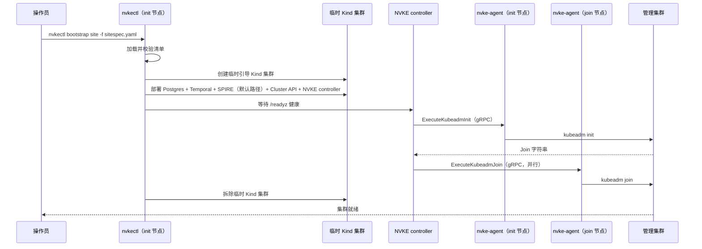

# 管理集群引导

## 概述

本指南介绍如何部署自管理管理集群——即运行 NVKE 工作流引擎、数据库和安全服务的 Kubernetes 集群。

流程分三步：

1. [准备节点](pre-provisioned-nodes.md#step-1-prepare-all-nodes) — 安装 `nvke-agent` 和 Kubernetes 组件
2. [编写站点配置文件](configuration.md) — 声明节点、版本和镜像仓库
3. [运行 `nvkectl bootstrap site`](pre-provisioned-nodes.md#step-2-run-bootstrap-on-init-node) — 引导集群

**总耗时**：三节点站点通常 10–15 分钟完成集群启动，之后还需部署 NVKE 服务栈。`nvkectl bootstrap site` 会等待 `--timeout`（默认 `30m`）让集群完成配置，站点规模更大时应调高该值。

## 引导期间发生了什么

`nvkectl bootstrap site` 不只是调用 kubeadm。它先在 init 节点上启动一个临时 Kind 集群，在其上部署自包含的 NVKE 管理平面（Postgres、Temporal、SPIRE、Cluster API 各 provider 以及 NVKE controller）——`--disable-mtls`（仅开发用的明文模式）会跳过 SPIRE——然后用该 controller 通过 `nvke-agent` 的 gRPC API 对实际节点驱动 init 和 join 工作流，无需 SSH。

引导成功后临时 Kind 集群会被拆除。若传入 `--keep-bootstrap-cluster`，或站点集群创建后运行失败（`infra.provider: nico` 时，创建请求无响应也算），则保留该集群——恢复步骤见[预配置节点](pre-provisioned-nodes.md)。使用 `infra.provider: nico` 时，应改用[保留的引导集群](../../cli/docs/bootstrap-troubleshooting.md#release-the-nico-instances-first)：仅删除 Kind 集群会留下已分配但无人管理的 NICo 实例；且所有控制平面节点加入后只会删除 Kind 集群。

## 引导之后

集群启动后，先在其上安装 Cluster API 和基础设施 provider，再通过 GitOps 工具部署 NVKE 服务（NVKE controller、Temporal、CNPG）——顺序原因见[基础设施 Provider](infrastructure-providers.md)，ArgoCD 应用结构见[部署仓库](deploy-repository.md)。

集群的 etcd 数据从首次 `kubeadm init` 起即静态加密，每个控制平面节点都持有密钥。引导还会将其保存到工作目录下的 `<clusterName>-etcd-encryption-key.json`（用 `--encryption-key-out` 指定路径）：这既方便后续安装的 controller 直接使用该文件而无需从节点提取密钥，也是灾难恢复副本——恢复到新主机时没有节点可供提取。请将文件移出主机并妥善保管。见[预配置节点](pre-provisioned-nodes.md#troubleshooting)。

若运行自管理站点（以 NICo 为基础设施 provider），需保留 `nvkectl` 以供后续操作。将 NICo 本身安装到站点集群见[基础设施 Provider](infrastructure-providers.md)。

## 站点维护

计划内更新站点管理集群证书时，使用[手动证书续期流程](../site-operations/certificate-renewal.md)。

## 后续步骤

- [安装](installation.md) — 构建并安装 `nvkectl`
- [配置](configuration.md) — 编写站点配置文件
- [预配置节点](pre-provisioned-nodes.md) — 准备节点并运行引导
- [自定义基础 OS](custom-base-os.md) — 基于 cloud-init 的节点准备
- [部署仓库](deploy-repository.md) — 引导后部署 NVKE 服务
- [基础设施 Provider](infrastructure-providers.md) — 在 NVKE controller 之前安装 Cluster API 和 CAPNICo